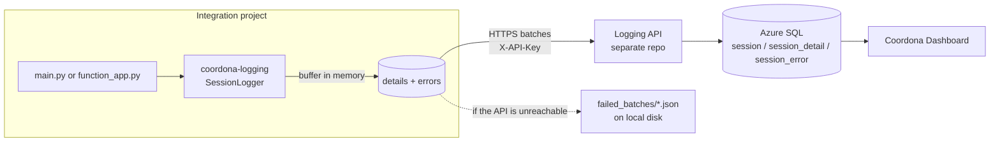

# Knowledge Transfer: coordona-logging

> 💡 **Reading this in VS Code?** Press **`Ctrl + Shift + V`** to open the formatted preview, so the tables and diagrams show properly. GitHub shows it formatted automatically.

---

> **Repo:** `coordona/coordona-logging`
> **Type:** Small installable Python library (`pip install`), not an app. There is nothing to deploy.
> **Runtime:** Python 3.9+, one required dependency (`requests`), one optional (`tabulate`, for console tables)
> **Current version:** `0.1.0` (git tag `v0.1.0`)
> **Purpose:** The shared logging client every Coordona integration uses to record its runs. It times each step, captures errors, buffers everything in memory and sends it to the **Logging API** in batches. The **Coordona Dashboard** then reads those records to show each integration's health.

---

## Table of contents

1. [The big picture](#1-the-big-picture)
2. [Repository layout](#2-repository-layout)
3. [Core concepts](#3-core-concepts)
4. [Using it in a sequential project](#4-using-it-in-a-sequential-project)
5. [Using it in a parallel project (Durable Functions)](#5-using-it-in-a-parallel-project-durable-functions)
6. [Logging warnings and info notes](#6-logging-warnings-and-info-notes)
7. [Batching, retries and the fallback folder](#7-batching-retries-and-the-fallback-folder)
8. [What gets sent to the Logging API](#8-what-gets-sent-to-the-logging-api)
9. [Configuration](#9-configuration)
10. [Working on the library locally](#10-working-on-the-library-locally)
11. [Releasing a new version](#11-releasing-a-new-version)
12. [Troubleshooting](#12-troubleshooting)
13. [Known gotchas and tech debt](#13-known-gotchas-and-tech-debt)

---

## 1. The big picture



**In one sentence:** an integration wraps its work with this library; each run becomes one **session** row, each step one **session_detail** row, and each error or note one **session_error** row, all posted to the Logging API in bulk instead of one HTTP call per function.

**Systems involved**

| System | Role |
|---|---|
| **This library** | Lives inside each integration's process. Times steps, catches errors, batches and sends. |
| **Logging API** (separate repo) | Receives the records and writes them to Azure SQL. Checks the `X-API-Key` header against its own `API_KEY` setting. |
| **Azure SQL** | Stores `session`, `session_detail`, `session_error`. The `project_id` sent must match a row in `dbo.project`. |
| **Coordona Dashboard** (`coordona/coordona-dashboard`) | Reads those tables, shows health per project, raises tickets and sends emails on **Critical** errors. |

---

## 2. Repository layout

| Path | What it does |
|---|---|
| `src/coordona_logging/__init__.py` | Public API: exports `SessionLogger`, `build_logger`, `LoggingPipeline`, `run_sequential_pipeline`, plus `__version__` (read from the installed package metadata). |
| `src/coordona_logging/batch_logger.py` | **The core.** `SessionLogger`: session start/end, the `track()` decorator, `log_note()`, buffering, background flush thread, HTTP retries, fallback-to-disk, console tables. Start here. |
| `src/coordona_logging/logging_config.py` | `build_logger(mode)`: builds a `SessionLogger` from environment variables. |
| `src/coordona_logging/pipeline_logging.py` | The two high-level entry points: `run_sequential_pipeline` and `LoggingPipeline` (Durable Functions). Most projects only ever touch these. |
| `pyproject.toml` | Package name, version, dependencies, the `[console]` extra. |
| `README.md` | Short install + usage summary. |
| `LICENSE` | MIT. |
| `dist/`, `.venv/`, `*.egg-info/`, `failed_batches/` | Local build output / scratch. All git-ignored. |

---

## 3. Core concepts

### Records

| Record | One per | Created by | Key fields |
|---|---|---|---|
| **session** | Pipeline run | `session()`, `log_session_start/end`, `LoggingPipeline` | `id`, `project_id`, `start_datetime`, `end_datetime`, `status` (`Running` → `Completed` / `Failed`) |
| **session_detail** | Tracked function / step / table | `track()`, `run_tracked()` | `id`, `session_id`, `function_name`, `start_time`, `end_time`, `duration` (seconds), `success`, `status` |
| **session_error** | Exception or note | an exception inside `track()` (**Critical**), or `log_note()` (**Warning** / **Info**) | `id`, `session_detail_id`, `timestamp`, `error_level`, `error_message`, `stacktrace` |

All timestamps are generated in **UTC** (ISO 8601). All ids are UUIDs generated client-side.

### Modes: `"sequential"` vs `"parallel"`

The mode **only changes console printing**. Batching and API calls are identical in both.

| | `sequential` | `parallel` |
|---|---|---|
| Shape of project | One process, `main.py` runs steps one after another (e.g. Waverly) | Many units of work at once, e.g. Azure Durable Functions fanning out one activity per table (e.g. sf-to-snowflake) |
| Console output | Clears the screen and reprints a cumulative table after **every** step | Nothing per step; one summary table at the end via `print_summary` |
| Entry point | `run_sequential_pipeline` | `LoggingPipeline` + `run_tracked` |
| Logger instances | One for the whole run | A fresh one per activity (activities can't share memory) |

`SessionLogger`'s own default mode is `"parallel"`; `build_logger(mode)` makes you choose explicitly.

---

## 4. Using it in a sequential project

**requirements.txt**
```
coordona-logging[console] @ git+https://github.com/coordona/coordona-logging.git@v0.1.0
```
(Drop `[console]` if you don't want the live table.)

**main.py**
```python
from functools import partial
from coordona_logging import build_logger, run_sequential_pipeline
import my_steps

run_sequential_pipeline(partial(build_logger, "sequential"), steps=[
    ("extract_account", my_steps.extract_account),
    ("load_account",    my_steps.load_account),
    ("extract_contact", my_steps.extract_contact),
])
```

What happens:
1. A session row is posted as **Running**, and a background thread starts flushing every 30 s.
2. Each step runs in order, timed and logged under the name you gave it.
3. If a step raises, its error is logged as **Critical**, the remaining steps **do not run**, the session is marked **Failed**, and the original exception is re-raised.
4. On the way out (success or failure) everything left is flushed and the session is closed.

It returns a list of each step's return value.

**Lower-level alternative** (if you need more control):
```python
logger = build_logger("sequential")
with logger.session():
    @logger.track
    def step_one(): ...
    step_one()
```

---

## 5. Using it in a parallel project (Durable Functions)

**function_app.py**
```python
from functools import partial
from coordona_logging import build_logger, LoggingPipeline

build_logger_parallel = partial(build_logger, "parallel")

durable_app = df.DFApp(http_auth_level=func.AuthLevel.ANONYMOUS)

# At import time: registers 3 activities on durable_app:
#   activity_log_session_start, activity_log_session_end, activity_print_summary
pipeline = LoggingPipeline(durable_app, build_logger_parallel, title="My Pipeline Summary")

@durable_app.orchestration_trigger(context_name="context")
def orchestrator_pipeline(context):
    run_start_time = context.get_input()["run_start_time"]

    session_id = yield from pipeline.start(context, run_start_time)

    tasks = [context.call_activity("activity_process_table", {**t, "session_id": session_id})
             for t in table_payloads]
    results = yield context.task_all(tasks)

    failed = [r["table"] for r in results if not r["success"]]
    yield from pipeline.finish(context, results, session_id, run_start_time, failed=bool(failed))
    return {"status": "partial_failure" if failed else "success", "failed": failed}

@durable_app.activity_trigger(input_name="payload")
def activity_process_table(payload):
    table = payload["table"]
    def _run_table():
        ...  # real fetch / upload / load
    result = build_logger_parallel().run_tracked(table, _run_table, payload["session_id"])
    result["table"] = table
    return result
```

Things that matter here:
- **`pipeline.start` uses `context.new_uuid()`**, not `uuid4()`, because orchestrator code is replayed and the id must be the same on every replay.
- **`run_tracked` never raises.** It returns `{"success": bool, "error": str | None}` and always flushes in `finally` (activities have no background flush thread).
- **Call `pipeline.finish` on every exit path** of the orchestrator, including failure branches. Otherwise the session stays **Running** forever (the dashboard then shows it as Stalled).
- The activity names `activity_log_session_start/end` and `activity_print_summary` are reserved by the library; don't define your own with those names.

---

## 6. Logging warnings and info notes

For "something worth noting, but the step still succeeded" (a retry, a skipped row, a fallback to a default):

```python
def load_account():
    ...
    logger.log_note("Skipped 3 rows with no email", level="Warning")
```

- Levels: `"Warning"`, `"Info"` (and `"Critical"`, though real failures should just raise).
- It attaches automatically to whichever tracked step is currently running on that logger. Called outside a tracked step, the note is **dropped** with a log warning.
- It does **not** mark the step as Failed.
- You need a reference to the logger instance. With `run_sequential_pipeline` the logger is created inside the function, so if you need notes, use the lower-level `with logger.session()` / `@logger.track` style, or build the logger yourself and pass it to your steps.

Only **Critical** errors trigger the dashboard's error tickets and emails.

---

## 7. Batching, retries and the fallback folder

| Setting | Default | Where |
|---|---|---|
| Flush when buffered step records reach | **50** | `flush_threshold` |
| Background flush interval (sequential `session()` only) | **30 s** | `flush_interval_seconds` |
| HTTP retries | 3, exponential backoff, on connection errors (the 500/502/503/504 list is configured but doesn't apply to POST, see §13) | `Retry(...)` in `SessionLogger.__init__` |
| Timeouts | 15 s single post, 30 s bulk post | `_post`, `_post_bulk` |
| Fallback folder | `/tmp/failed_batches` (via `build_logger`), `failed_batches` (direct `SessionLogger`) | `LOGGING_FALLBACK_DIR` |

If a send still fails, the batch is written as JSON to the fallback folder (`api_v1_session-detail_bulk_<uuid>.json` etc.) and a warning `Wrote failed batch to ...` is logged. **Nothing replays these files automatically** (see §13).

`/tmp` is used by default because it's the only writable path in Azure Functions; it is also wiped when the instance recycles.

---

## 8. What gets sent to the Logging API

All requests: `POST`, header `X-API-Key: <LOGGING_API_KEY>`, `Content-Type: application/json`.

| Endpoint | Body |
|---|---|
| `/api/v1/session` | One session object (posted at start as `Running` with `end_datetime = start`, then again at the end with the same `id` and the final status, so the API has to treat the second post as an update) |
| `/api/v1/session-detail/bulk` | `{"records": [ ...session_detail... ]}` |
| `/api/v1/session-error/bulk` | `{"records": [ ...session_error... ]}` |

Field names are in §3. If you change any of these shapes, the Logging API (and possibly the dashboard) must change too.

---

## 9. Configuration

Read by `build_logger()` from environment variables: `local.settings.json` locally for Functions projects, a `.env`/shell for plain scripts, and **Application Settings** in Azure.

| Variable | Meaning | Secret? |
|---|---|---|
| `PROJECT_ID` | Exact `id` of the project's row in `dbo.project` (e.g. `PRJ-001`). Must match or the run won't show on the dashboard. | No |
| `LOGGING_API_BASE_URL` | e.g. `https://<logging-api>.azurewebsites.net` (no trailing slash needed) | No |
| `LOGGING_API_KEY` | Must equal `API_KEY` on the Logging API | **Yes**, share privately, never commit |
| `LOGGING_FALLBACK_DIR` | Optional, default `/tmp/failed_batches` | No |

A missing required variable fails immediately with `KeyError: 'PROJECT_ID'` (etc.).

---

## 10. Working on the library locally

```powershell
cd C:\Users\<you>\coordona-logging
python -m venv .venv
.\.venv\Scripts\Activate.ps1
pip install -e ".[console]"
```

`-e` (editable) means changes in `src/` take effect without reinstalling. To try a change inside a real integration, activate *that* project's venv and run `pip install -e C:\Users\<you>\coordona-logging`.

Quick smoke test (posts to whatever API the variables point at, so use a test project id):
```python
from functools import partial
from coordona_logging import build_logger, run_sequential_pipeline
run_sequential_pipeline(partial(build_logger, "sequential"), steps=[("hello", lambda: 1)])
```

There are no automated tests yet.

---

## 11. Releasing a new version

Integrations pin a **git tag**, so a release is just a tag:

1. Bump `version` in `pyproject.toml` (e.g. `0.1.0` → `0.2.0`; bump the major/minor for anything that changes behaviour or the API payloads).
2. Update the version in the `README.md` install lines.
3. Commit and push to `main`.
4. Tag and push the tag:
   ```powershell
   git tag v0.2.0
   git push origin v0.2.0
   ```
5. In each integration that should take it, change `@v0.1.0` → `@v0.2.0` in `requirements.txt` and redeploy that integration.

Existing integrations keep running the old version until they're updated, so never move or delete an existing tag. Building `dist/` (`python -m build`) is optional; nothing installs from it today.

---

## 12. Troubleshooting

| Symptom | Likely cause / fix |
|---|---|
| `KeyError: 'PROJECT_ID'` (or another variable) | Variable not set in `local.settings.json` / Application Settings. |
| `TypeError: build_logger() missing 1 required positional argument: 'mode'` | Passed `build_logger` instead of `partial(build_logger, "sequential"/"parallel")`. |
| Run doesn't appear on the dashboard | `PROJECT_ID` doesn't match `dbo.project.id`, wrong `LOGGING_API_BASE_URL`, or wrong key (look for `Failed to POST` / `401` / `403` in logs). |
| `Wrote failed batch to ...` in the logs | The API was unreachable or rejected the request. Check the API is up and the key matches; the records are in the fallback folder. |
| Session stuck on **Running** / dashboard says Stalled | The process was killed before the session closed, or (parallel) `pipeline.finish` wasn't called on that exit path. |
| No console table | `tabulate` isn't installed (install the `[console]` extra). A warning says so. In parallel mode, check the Functions log stream; tables only print once at the end. |
| Garbled characters in the summary on Windows | `func start` uses a cp1252 console; non-ASCII titles are replaced with `?`. Cosmetic only. |
| `pip install` fails to clone the repo | The tag in the URL doesn't exist (check `git ls-remote --tags origin`), or the machine can't reach github.com. |

Logger name to filter on: `batch_logger`.

---

## 13. Known gotchas and tech debt

1. **Fallback files are never replayed.** There's no tool to resend `failed_batches/*.json`, and in Azure Functions `/tmp` disappears when the instance recycles, so in practice failed batches there are lost. A small replay script (or the API accepting the same files) would close the gap.
2. **5xx responses are not retried, because every call is a POST.** `urllib3`'s `Retry` only retries a status code for methods in `allowed_methods`, and the default list (`HEAD, GET, PUT, DELETE, OPTIONS, TRACE`) excludes `POST`. Connection errors are still retried. Adding `allowed_methods=None` (retry any method) to the `Retry(...)` call would make the "3 retries on 500/502/503/504" in §7 actually happen. Safe here because session posts are upserts and the bulk records carry client-generated ids, but confirm the API ignores duplicate ids first.
3. **Retries are only mounted for `https://`.** A plain `http://` API URL (e.g. a local API) gets no retries.
4. **A logging failure can break a sequential run.** `flush()` is called from inside `track()`'s `finally`; if the fallback folder can't be written (permissions, disk full) that `OSError` escapes and replaces the step's real result or exception.
5. **Step functions are renamed in place** (`func.__name__ = name`). That fails with `AttributeError` for a **bound method** (`obj.method`) and permanently renames shared functions. Wrap them in a `lambda` or a small `def` if needed.
6. **Docstrings are out of date.** `pipeline_logging.py` and the usage notes in `batch_logger.py` still show `from logging_config import build_logger` and `build_logger()` with no mode, from before this was a package. The README and this KT have the correct form.
7. **`log_note` can't be reached through `run_sequential_pipeline`**, since the logger is created inside it (§6).
8. **`_current_detail_id` is a plain attribute**, not thread-local. If a sequential step starts its own threads that call `log_note`, notes can attach to the wrong step.
9. **Only the step buffer is size-checked.** Errors/notes have no threshold; they go out with the next step flush.
10. **The sequential live table clears the whole terminal** (`cls`/`clear`) after every step, which also wipes other output.
11. **The repo is public.** Anyone can read the code and install it, which is why integrations can `pip install` it from GitHub with no token. Never commit real keys, URLs of internal APIs, or project ids here; they belong in each integration's settings (§9).
12. **No automated tests or CI.** Changes are verified by running a real integration against the API.
